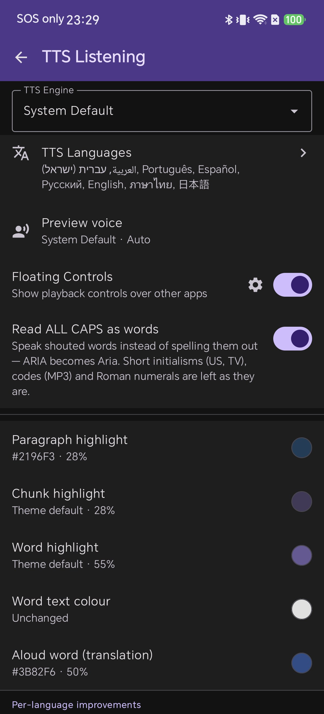
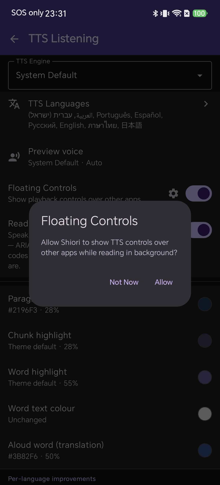
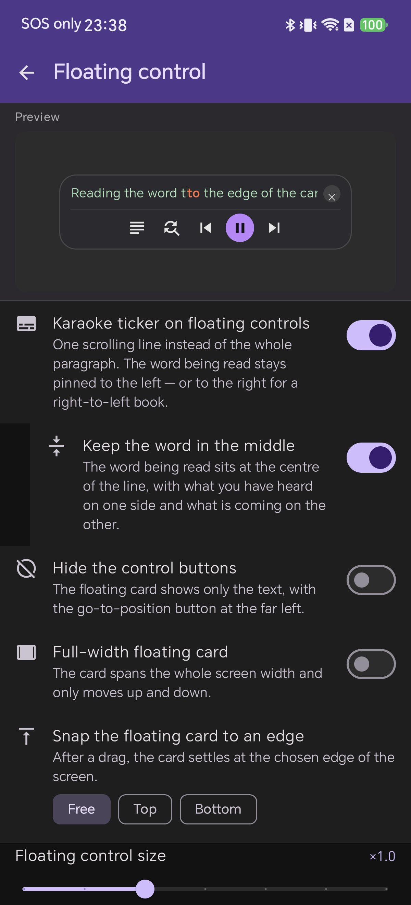
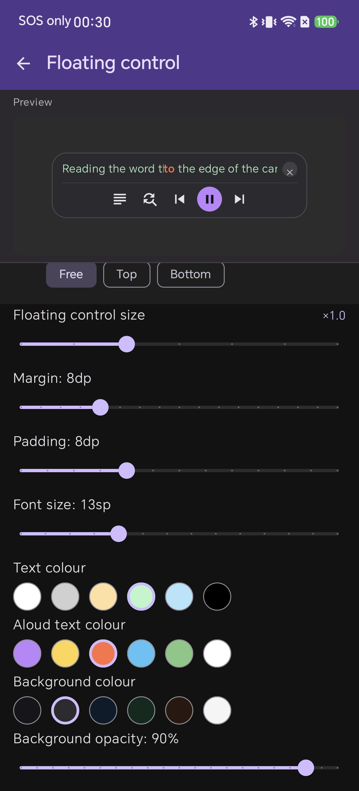
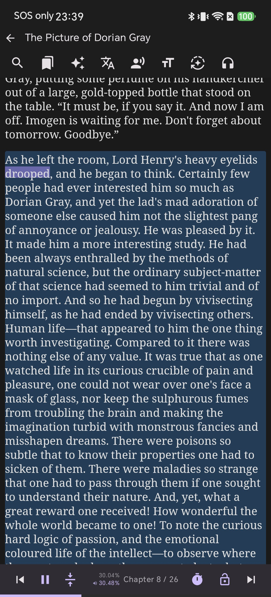
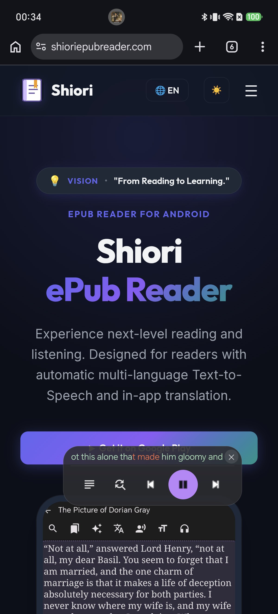
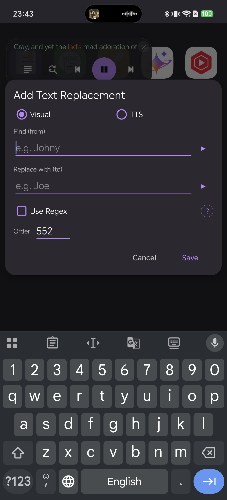

# 在使用其他应用时持续畅听电子书：Shiori 悬浮窗朗读控制面板全指南

在使用后台语音朗读（TTS）功能听书时，我们经常需要切出应用去处理即时通讯软件的消息。然而此时音频依然在后台播放，一旦需要暂停、倒回某句话，或者核对生僻词拼写，就必须退出当前界面重新切回阅读器，打乱了手头的操作节奏。

**Shiori 的“悬浮窗朗读控制面板（Floating Controls）”正是为解决这一痛点而生。** 开启此功能后，无论你正在使用哪款手机应用，Shiori 都会在屏幕最上层常驻显示一个精致实用的控制卡片。卡片不仅以单行卡拉OK形式实时高亮当前朗读的句子与词汇，更集成了完整的播控按钮——暂停、跳句或一键返回书中对应位置皆在指尖触达。

本指南将带你全面了解如何开启功能、授予系统权限、自由定制尺寸与配色，以及在多任务环境下的实际操作技巧。文中所展示的所有截图均在运行 Shiori 2.3.6 的 Android 真机上截取。

## 悬浮控制卡片的核心功能

悬浮控制卡片不仅是一个简单的播放/暂停小组件，在默认状态下它提供了极为丰富的核心控制能力：

* **单行卡拉OK滚动条（Karaoke line）：** 动态滚动显示正在朗读的单行文本，并以醒目色彩高亮当前发音词，无需切回图书即可同步阅读。
* **一键直达书中位置（Go to position）：** 点击最左侧的定位图标，即可快速唤醒 Shiori 阅读界面并直接跳转至当前语音朗读的书页段落。
* **快捷添加文本替换规则（Add text replacement）：** 听到多音字或专有名词发音错误时，点击直接呼出替换窗口快速修正读音，听书完全不中断。
* **上一句 / 播放暂停 / 下一句（Previous / Play-Pause / Next）：** 针对拇指单手触控专门优化的大尺寸播控键。
* **关闭按键（×）：** 点击即可一键移除悬浮卡片并彻底停止音频朗读。

## 准备工作

* 已安装 Shiori 阅读器的 Android 设备（本教程基于 2.3.6 版本制作）
* 书架中的任意电子书（本演示使用经典读物《道林·格雷的画像》）
* 正常发音的 Android 系统 TTS 引擎（系统自带默认引擎即可）
* “在其他应用上层显示”悬浮窗权限（开启开关时 Shiori 会自动引导授权）

## 第一步：开启 Floating Controls 悬浮控制器

1. 在书架主界面，点击顶部工具栏的设置齿轮图标（**Settings**）。
2. 点击进入 **TTS Listening** 听书设置页面。
3. 找到 **Floating Controls**（在其他应用上显示播控卡片）这一行，将右侧的开关打开。

此选项包含两个关键部分：右侧开关负责开启或关闭该功能，旁边的小齿轮图标则可进入外观与参数配置页面（我们将在第三步详细设置）。

## 第二步：授予在其他应用上层显示的系统权限

打开开关的瞬间，Shiori 会弹出系统授权提示：

> **Floating Controls** — Allow Shiori to show TTS controls over other apps while reading in background?

点击 **Allow**（允许）。这是 Android 系统的标准悬浮窗权限。若不授权，操作系统将阻止任何应用绘制在上层，悬浮卡片便无法显示。如果系统跳转到了 Android 权限管理列表，请在其中找到 Shiori 并允许该权限后返回。

若选择 **Not Now**，后台听书功能依然可以正常播放音频，但将不会在屏幕上显示悬浮控制器。

## 第三步：定制悬浮卡片的展示形态与吸附模式

点击开关旁边的齿轮图标进入 **Floating control** 详细配置页面。页面顶部配备了实时的 **Preview** 预览卡片，你的每一次参数改动都会即刻生效重绘。

该页面中的关键开关选项包括：

* **Karaoke ticker on floating controls：** 以单行滚动方式展示文本。从左向右语言中当前词靠左排列（阿拉伯语等 RTL 语言中靠右排列）。适合跟读时开启；若仅需播控按钮可将其关闭。
* **Keep the word in the middle：** 始终将朗读单词固定在正中央，前后文向两侧延伸，视线焦点无需频繁移动，跟读体验更佳。
* **Hide the control buttons：** 隐藏全部播控按键，将卡片精简为仅包含定位图标与文本的极简文字条。
* **Full-width floating card：** 将卡片宽度延展至整个屏幕宽度，此模式下仅支持上下垂直移动。
* **Snap the floating card to an edge：** 边缘智能吸附模式。**Free** 允许随意停留在任何松手位置；**Top** 与 **Bottom** 会在松手后自动平滑吸附至屏幕顶部或底部边缘。

## 第四步：微调尺寸、内外边距与色彩配色

在同一页面向下滑动，即可调节多项外观滑块参数：

| 设置项 | 默认值 | 控制效果 |
| --- | --- | --- |
| Floating control size | ×1.0 | 等比例整体缩放卡片及内部按键尺寸 |
| Margin | 8dp | 卡片与屏幕边界之间的外边距 |
| Padding | 8dp | 卡片边缘与内部文字/按键的内边距 |
| Font size | 13sp | 单行滚动条的文本字号大小 |
| Background opacity | 90% | 背景透明度，决定底层应用的透出程度 |

滑块下方提供三组调色板：用于正文文字的 **Text colour**、用于当前发音高亮词的 **Aloud text colour** 以及卡片底色的 **Background colour**。由于悬浮窗需要叠加在各种复杂的应用背景之上，对比度至关重要——在深色卡片底色上搭配高亮浅色文字和高不透明度，能确保在几乎所有界面上均清晰易辨。

如果你希望悬浮窗尽量少干扰视线，建议降低 **Background opacity**（背景透明度）而不是缩减卡片尺寸：一张半透明但字号适中的卡片，远比一张需要费力辨识的小尺寸卡片舒服得多。

## 第五步：在阅读器中开启听书朗读

只有当播放正在进行时，悬浮窗才会出现在屏幕上。从书架中打开任意图书，点击底部控制栏的 **Play** 播放按钮开启朗读。

当 Shiori 处于前台时，你将享受完整的阅读器界面：当前段落整体高亮、朗读单词实时追踪，以及底部章节进度条。

## 第六步：切出应用 — 悬浮卡片无缝跟随

此时切换到其他应用程序（如微信、浏览器）或返回桌面。悬浮卡片便会即刻常驻在最顶层，逐词同步跟进朗读进度。

你可以按住卡片主体将其拖曳至屏幕任意位置。若吸附设置为 **Free**，松手即停；若设置为 **Top** 或 **Bottom**，它会自动滑向对应边缘。如果不小心把卡片拖到了角落，只需 **双击卡片（Double-tap）**，它便会立即平滑重置回屏幕正中央。

## 第七步：全屏宽极简条状布局

如果默认卡片让你觉得占用空间过多，可同时打开 **Hide the control buttons**（隐藏控制按键）与 **Full-width floating card**（全宽卡片）。卡片将化身为一条极其纤细的横幅：仅保留定位图标、迷你暂停键、单行动词条和关闭按键。

此布局仅支持垂直上下拖动。你可以将其停泊在系统状态栏下方，或是底部手势操作栏上方，完全不会遮挡主应用的视觉与操作。

## 第八步：就地修正发音错误，无需切回图书

点击悬浮卡片上的第二个图标，无论你正在使用什么应用，都会就地弹出 **Add Text Replacement**（添加文本替换规则）对话框。

在 **Find (from)** 中输入书里的原文生词，在 **Replace with (to)** 中输入正确的读音或谐音，选择 **TTS** 模式（确保只改变发音而不修改书页正文），点击保存。无需中断手头的事项，短短数秒就能修正读音瑕疵，听书全程流畅进行。

## 常见问题解答与排查（FAQ）

**为什么开启后悬浮窗始终没有出现？**  
很可能是系统悬浮窗权限被拒绝或被限制。将 **Floating Controls** 开关关闭后重新开启以唤起系统授权弹窗，或前往手机的“系统设置 - 应用权限”中手动为 Shiori 开启“在其他应用上层显示”权限。

**悬浮卡片出现了，但只显示按钮不显示文字？**  
这是由于关闭了 **Karaoke ticker on floating controls** 开关，当前处于纯按键模式。返回设置重新开启该选项即可恢复文字滚动。

**在浅色或白色背景应用上方文字不够清晰？**  
将 **Background opacity**（背景透明度）调高至 90%–100%，并选择深黑色卡片背景搭配明亮黄色或白色字体，确保在任何色彩的背景上都具有极佳辨识度。

**卡片拖动到边缘不便操作如何快速归位？**  
快速 **双击卡片主体**，卡片会即刻跳回屏幕中央。你也可以将边缘吸附设为 **Top** 或 **Bottom** 保持固定停泊。

**点击关闭（×）后为什么朗读直接停止了？**  
这是设计上的预期交互——叉号用于关闭卡片并同步结束朗读。如果希望关闭悬浮窗但依然保持后台纯音频听书，只需在 Shiori 设置中关闭 **Floating Controls** 开关即可。

## 进阶实用技巧

* **原生兼容 RTL（从右向左）语言：** 在阅读阿拉伯语等书目时，卡拉OK条会自动自右向左排版跟读，完全符合阅读习惯。
* **一键书签秒回现场：** 结束多任务操作后，点击卡片最左侧的定位按键，即可快速将 Shiori 阅读器直接校准至刚刚听到的最新段落。
* **参数设置前善用实时预览：** 在 Floating control 设置页面的顶部卡片是动态响应的，调整好适宜字号与边距后再切出使用，省时省力。

## 相关阅读

* [在 Shiori EPUB 阅读器中使用卡拉OK同步高亮跟读](/blog/read-along-tts-karaoke-highlight-epub-android/)
* [Shiori 多语言语音朗读：智能语种识别与发音引擎自然切换](/blog/multi-language-text-to-speech-android-epub/)
* [在 Android 上点选文本朗读：轻松核对生僻字词读音](/blog/read-selected-text-aloud-epub-android/)
* [Android EPUB 阅读器的文本替换与正则表达式实用技巧](/blog/text-replacement-regex-epub-android/)

## 总结

Shiori 的悬浮窗朗读控制面板将听书时最核心的诉求——当前句子跟读与基础播控功能——巧妙提炼并悬浮在系统最顶层。无论是收发邮件、浏览网页还是聊天沟通，你都不必频繁切回应用，好书与知识时刻与你随行。
