# Configura la Lectura en Voz Alta Correctamente: Motor TTS, Idiomas y Prioridad en Shiori

La lectura en voz alta (Text-to-Speech) suele sonar mal por dos motivos principales: o bien el motor de síntesis de voz no es el adecuado, o el libro está en un idioma que la app no tiene habilitado. En el primer caso, todos los libros suenan planos y robóticos; en el segundo, un libro específico suena como una máquina deletreando un directorio telefónico.

Ambas configuraciones se gestionan en el mismo apartado de Shiori: **Settings → TTS Listening**. Esta pantalla reúne la selección del motor (**TTS Engine**) en la parte superior, la lista de idiomas (**TTS Languages**) justo debajo, y los ajustes individuales de tono (Pitch) y velocidad (Speed) de cada voz. Esta guía te explica el proceso en orden, haciendo especial hincapié en la **prioridad de idiomas**, que decide quién habla cuando dos lenguas comparten el mismo alfabeto.

Todas las capturas se tomaron en un dispositivo Android real con Shiori 2.3.6.

## Por qué el orden de la lista es fundamental

Shiori no te pregunta el idioma del libro al abrirlo. Examina directamente los caracteres en pantalla, divide cada párrafo en fragmentos del mismo alfabeto y envía cada fragmento a la voz correspondiente. Esto funciona a la perfección cuando un alfabeto pertenece exclusivamente a un idioma (el tailandés, por ejemplo, solo puede ser tailandés).

El dilema surge cuando dos idiomas comparten la misma grafía:

| Alfabeto en pantalla | Idiomas que pueden reclamarlo |
| --- | --- |
| Alfabeto latino | Español, inglés, portugués, alemán, francés, etc. |
| Caracteres Han (Kanji) | Tanto el chino como el japonés los utilizan |
| Alfabeto cirílico | Ruso y lenguas de la región |

Cuando dos idiomas habilitados reclaman los mismos caracteres, Shiori necesita un criterio de desempate, y ese criterio es el orden de la lista: **el idioma situado más arriba tiene la prioridad**. Como indica la propia app en la pantalla de TTS Languages, reordenar no es algo estético: para quien lee chino y japonés, marca la diferencia entre escuchar un libro en chino con pronunciación china o con entonación japonesa.

## Qué necesitas

* Shiori instalado en tu dispositivo Android (probado en v2.3.6)
* Al menos un motor de síntesis de voz en el dispositivo (el predeterminado del sistema sirve)
* Datos de voz descargados en los ajustes de Android para tus idiomas de lectura
* Un libro para hacer pruebas de lectura

## Paso 1: Abre TTS Listening

1. En la biblioteca, pulsa el engranaje de **Settings** en la barra superior.
2. Abre la sección **TTS Listening** (marcada con el icono de auriculares).

Fíjate en el subtítulo bajo esta fila: enumera los idiomas habilitados en orden de prioridad. Si un libro se lee con la voz equivocada, esta línea te dice por qué antes de entrar en la pantalla.

La pantalla presenta los dos ajustes clave arriba —**TTS Engine** y **TTS Languages**—, seguidos de **Preview voice**, los controles flotantes, colores de resaltado y la sección **Per-language improvements** al final.

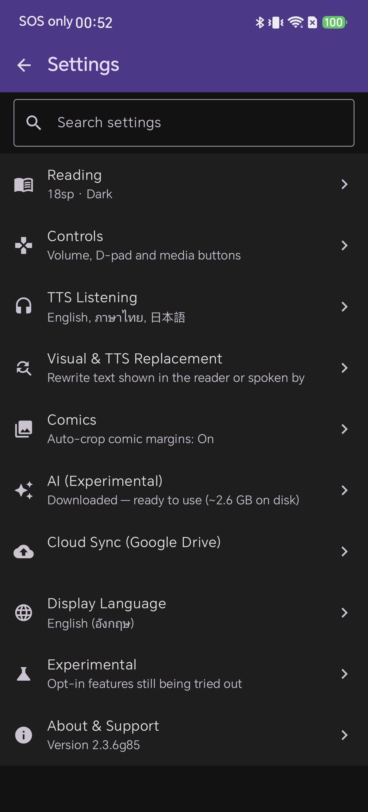
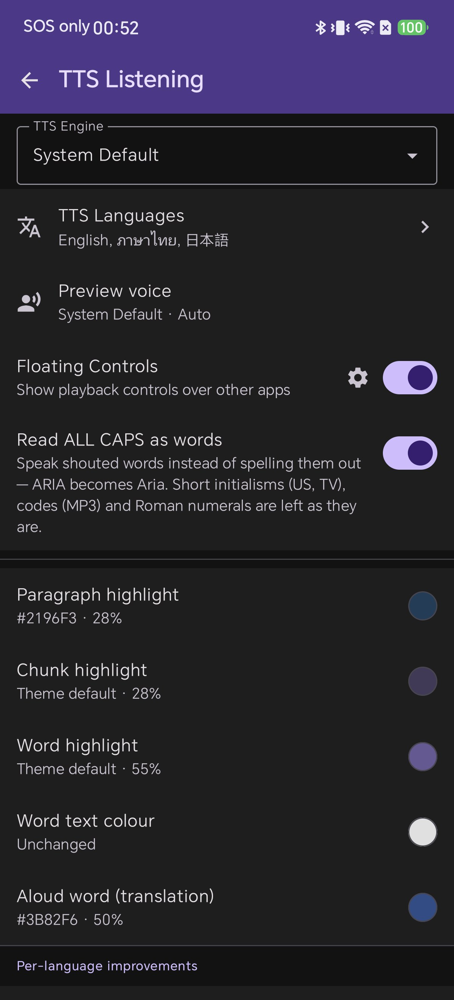

## Paso 2: Elige el motor de síntesis (TTS Engine)

Toca el desplegable **TTS Engine**. Muestra todos los motores instalados en tu móvil, además de **System Default** (Predeterminado del sistema).

En el terminal de prueba aparecen *System Default* y *Servicios de Voz de Google*. Tu lista dependerá de tu marca de móvil y de las apps que hayas instalado desde Google Play.

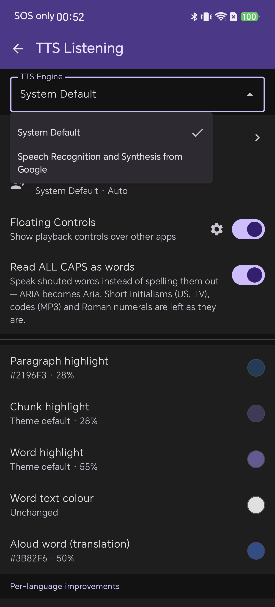

**¿Cuál debes elegir?**

* **System Default:** La opción más práctica. Aplica el motor configurado en los ajustes de Android de forma unificada.
* **Elegir un motor específico:** Muy útil si un motor ofrece mejores voces para tu idioma nativo o si prefieres no alterar el motor predeterminado de otras apps.

Este ajuste determina la calidad general del sonido, ya que el motor suministra las voces disponibles.

## Paso 3: Entiende para qué sirve "Preview voice"

Toca **Preview voice** y lee la primera línea de la ventana:

> Se utiliza en los botones de prueba y en la lectura puntual de selecciones, no en la narración continua del libro.

Este cuadro controla únicamente los botones de reproducción ▶ de los ajustes y la acción "Leer texto seleccionado en voz alta", **no** la voz que lee tus libros. Tiene su propio selector de motor y chips de idioma con opción **Auto**.

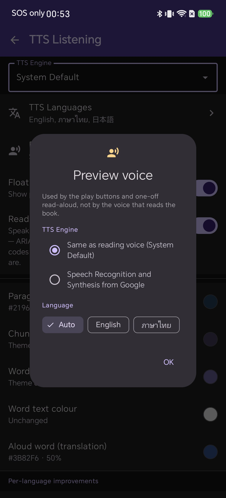

Es una duda habitual: cambiar el motor aquí mejora la muestra de prueba, pero el libro sigue sonando igual. Para cambiar la lectura del *libro*, modifica el TTS Engine en el Paso 2 y las voces en el Paso 6.

## Paso 4: Habilita los idiomas que lees

En la pantalla TTS Listening, pulsa **TTS Languages**.

Aparece la lista completa de idiomas. Los habilitados se sitúan arriba marcados con casilla; el resto figuran abajo en gris. Cada fila tiene las flechas de prioridad **▲ ▼**, la casilla, el nombre nativo y el desplegable de ajustes.

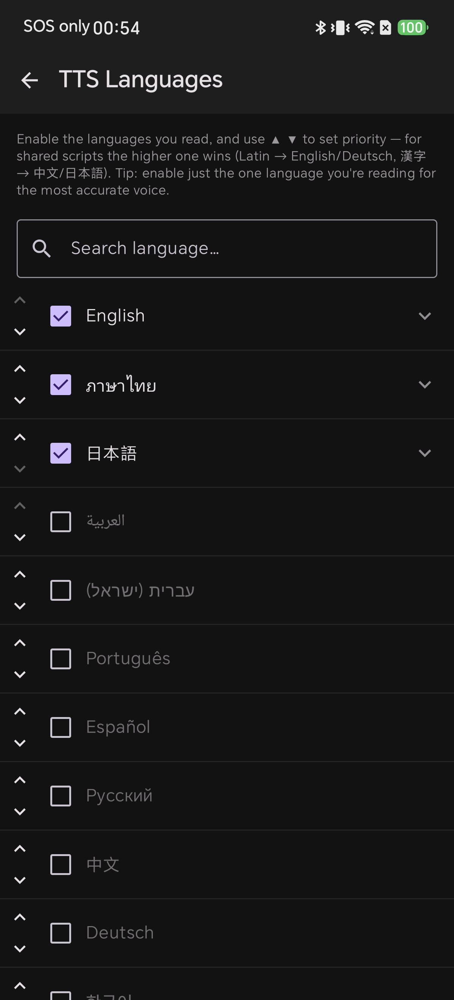

Marca solo los idiomas que leas habitualmente. Menos idiomas activos aseguran una detección más precisa al reducir conflictos de caracteres compartidos.

**Búsqueda rápida:** Usa la casilla **Search language…**. Como los nombres aparecen en su grafía original, si no encuentras un idioma por su nombre en español o inglés, introduce su código de dos letras (ej: `zh` para chino).

Los idiomas recién marcados se añaden al **final** del bloque activo (el chino quedará por debajo del japonés, algo que corregiremos en el Paso 5).

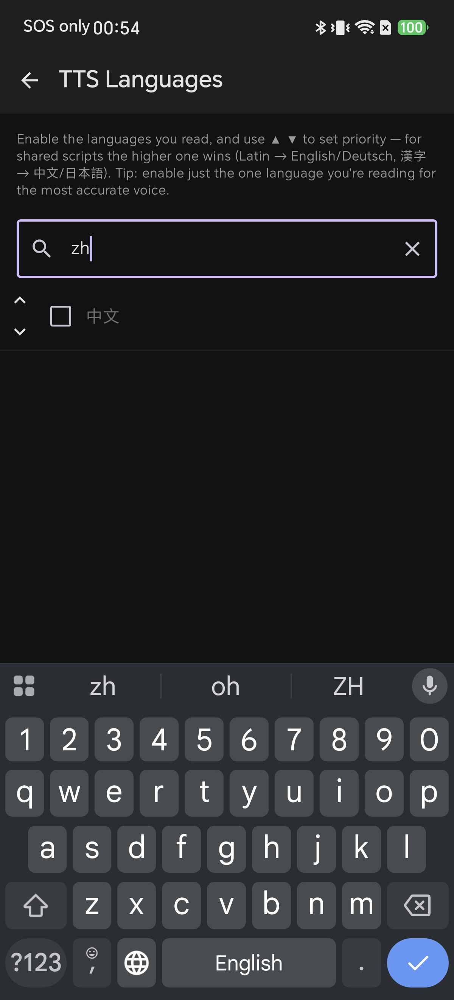

## Paso 5: Ordena la prioridad de los idiomas

Este paso soluciona que un libro en chino sea leído con pronunciación japonesa.

Al compartir los caracteres Han (Kanji), el idioma que esté más arriba en la lista asume su lectura. En la primera captura, el japonés está encima del chino y se apropia de los caracteres Han.

Pulsa la flecha **▲** en la fila del chino. Cambiará de posición con el japonés y ahora los caracteres Han serán leídos con voz china.

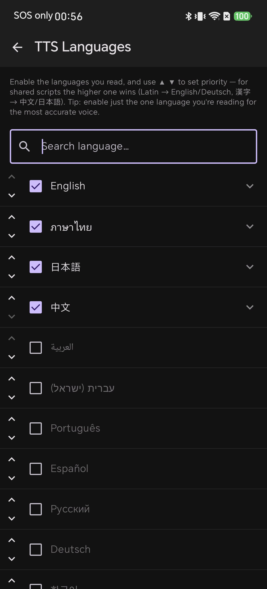
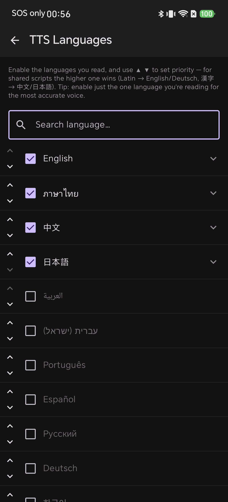

Reglas clave:

* **Las flechas solo mueven idiomas dentro del grupo activo:** La flecha ▼ del último idioma activo queda inactiva.
* **El orden es global:** Define tu criterio: "si hay ambigüedad en el texto, prioriza este idioma".
* **Solo afecta a caracteres compartidos:** Subir el chino no altera la pronunciación del texto en español ni en inglés.

Aplica la misma lógica con el alfabeto latino: coloca arriba el idioma que leas con más frecuencia.

## Paso 6: Ajusta tono, velocidad y voz para cada idioma

Toca la flecha derecha de cualquier fila activa para desplegarla:

* **Pitch (Tono)** y **Speed (Velocidad)**: controles deslizantes sobre el valor estándar
* **▶ preview**: botón de prueba para escuchar una frase de ejemplo en ese idioma
* **Menú Voice**: listado con todas las voces provistas por el motor

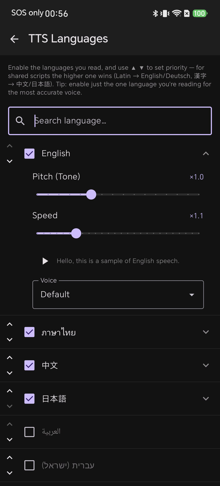

La configuración independiente te permite escuchar tu lengua materna a mayor velocidad y poner un ritmo pausado en idiomas que estás aprendiendo.

## Paso 7: Elige una voz — offline u online y acentos

Abre el menú **Voice** en el idioma desplegado. Bajo **Default**, verás las voces clasificadas por región y conexión:

* **Offline / Online:** Las voces *Offline* funcionan sin gastar datos y en modo avión. Las voces *Online* se procesan en la nube con una calidad mucho más humana, pero requieren conexión activa.
* **Prefijos regionales:** Permiten escoger acentos locales (ej: inglés de EE. UU., británico, australiano).

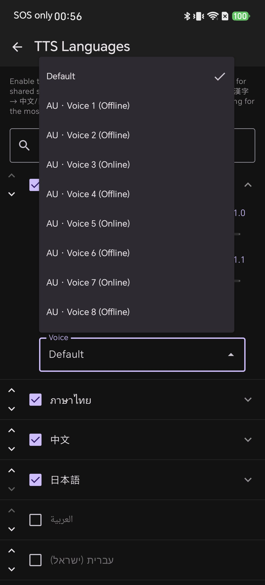

## Paso 8: Revisa las mejoras específicas por idioma

Al final de TTS Listening encontrarás **Per-language improvements**. Con el tailandés activo, por ejemplo, aparecen herramientas clave:

* **Thai word segmentation:** divide palabras en idiomas que no usan espacios, evitando errores de silabación.
* **Thai word dictionary:** diccionario para corregir nombres propios complejos.

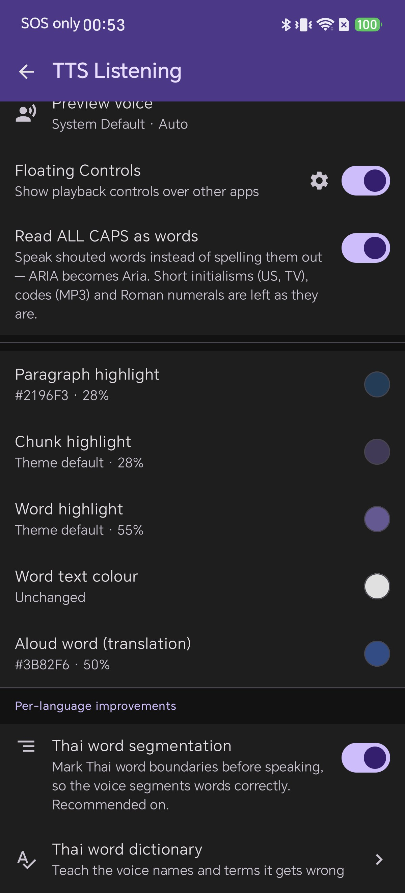

## Paso 9: Realiza cambios en directo sin salir del libro

No necesitas volver a los ajustes mientras lees. En el lector, el icono de auriculares abre un panel superpuesto con la misma lista de idiomas, casillas, flechas **▲ ▼** y barras de tono y velocidad.

El idioma que está leyendo en ese momento es siempre el que encabeza la lista del panel.

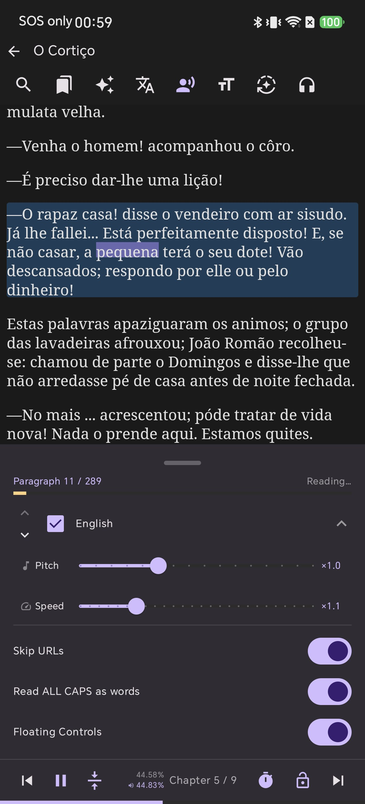

## Paso 10: Detección automática de idiomas no configurados

Si abres un libro con un alfabeto que no está cubierto por ningún idioma activo, Shiori te avisará con un diálogo inteligente:

> **Enable Arabic voice?** — Este libro parece estar en árabe, pero el idioma no está activado. ¿Deseas activarlo para usar la voz correcta?

Pulsa **Enable** y el idioma se activará situándose en la **primera posición** de la lista automáticamente, haciendo que la narración continúe con la voz perfecta de inmediato.

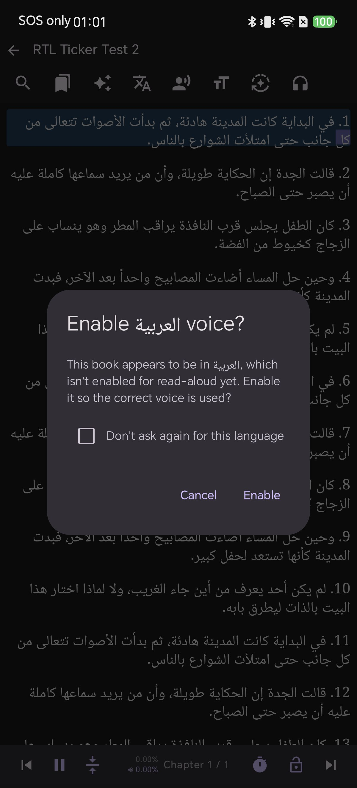
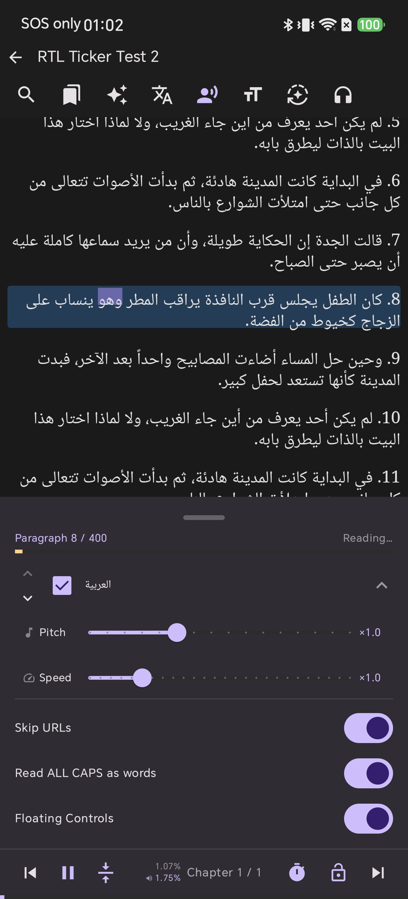

## Resumen de configuraciones recomendadas

| Tu hábito de lectura | Qué activar | Orden sugerido |
| --- | --- | --- |
| Solo un idioma | Únicamente ese idioma | Sin ordenar (máxima precisión) |
| Español + términos en inglés | Español e inglés | Español arriba; inglés asume palabras anglosajonas |
| Chino y japonés | Ambos (+ inglés) | El que leas con más frecuencia arriba (controla los caracteres Han) |
| Varios idiomas europeos | Solo los que realmente lees | El idioma principal arriba |

## Preguntas frecuentes (FAQ)

**El libro se lee en el idioma incorrecto.**  
Dos idiomas activos comparten alfabeto. Abre TTS Languages o el panel del lector y sube el idioma adecuado con la flecha ▲.

**La voz no suena sin Wi-Fi.**  
Tienes seleccionada una voz *Online*. Elige una voz *Offline* en el menú Voice antes de salir de casa.

**La voz suena artificial o robótica.**  
Depende del motor TTS. Cambia de motor en el Paso 2 o escoge una voz de alta calidad en el Paso 7.

## Conclusión

El motor determina cómo suenan las voces; el orden de la lista determina cuál de ellas habla. Configura tu motor una vez, activa solo los idiomas que lees y mantén tu lista ordenada para disfrutar de una lectura auditiva perfecta en cualquier libro.
