# How to Use Google Fonts in Shiori: Download a Font and Set It Per Language

The font a book is read in is not a small thing. It decides how long you can read before your eyes give up, and in some scripts it decides whether the text is even correct — Thai tone marks and vowels sit above and below the line, and a font that places them badly turns a paragraph into a mess.

Shiori lets you import your own `.ttf` or `.otf` files and assign a **different font to each script**. What the app cannot do is find fonts for you. This guide covers the part that comes before the import: choosing a font on **Google Fonts**, downloading it onto the phone, getting a usable font file out of the ZIP, and then wiring it up — one font for Thai, another for Latin — and watching the same page change.

It also covers the thing that goes wrong most often, because it went wrong while this guide was being written: **you do everything correctly and the page looks identical.** There is a section on that below, with the screenshots that explain it.

Everything here was done on a real Android phone running Shiori 2.3.6. Google Fonts is free, and the fonts used are published under the SIL Open Font License.

## Two things to know before you start

**A font only covers the scripts it was drawn for.** A beautiful Latin serif contains no Thai letters at all. Assign it to the Thai row and the system quietly falls back to something else — so nothing appears to happen, and you conclude the feature is broken.

**Google Fonts gives you a ZIP, not a font.** Tapping the download button on a phone leaves an archive in your Downloads folder. Shiori's importer asks for a `.ttf` or `.otf`, so the archive has to be unpacked first.

## What you need

- Shiori installed on an Android device (this walkthrough uses v2.3.6)
- A browser, to reach [fonts.google.com](https://fonts.google.com)
- Any file manager that can extract a ZIP — the one that ships with your phone is fine
- A book with text in the script you want to restyle, to check the result

## Step 1: Filter Google Fonts by writing system

Open **fonts.google.com** in the phone's browser and tap **Filters**. Under **Language** there are two dropdowns: **Writing system** and **Language**. Open **Writing system**, type the script you need — here, Thai — and tick it.

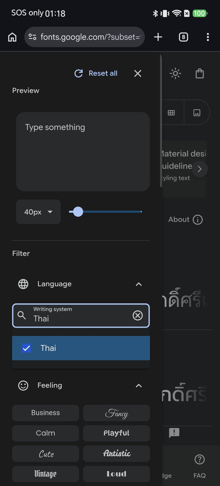

Close the panel and look at the count above the list. It drops from **1,946 families to 34**.

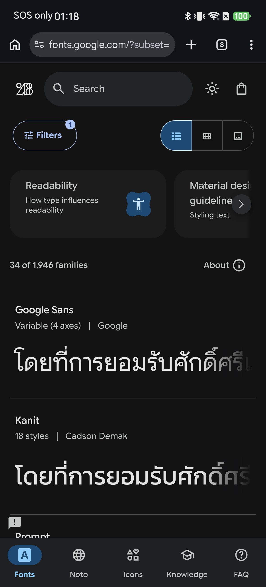

That number is the point of this step. Thirty-four families can render Thai; the other nineteen hundred cannot, however good they look in the catalogue. Filter first and everything you see afterwards is a real candidate.

Do it once per script you read. If you read Thai novels and English non-fiction, you are choosing two fonts, not one.

## Step 2: Read the specimen before you commit

Tap a family to open its specimen page. This walkthrough uses **Maitree**, a Thai text face by Cadson Demak.

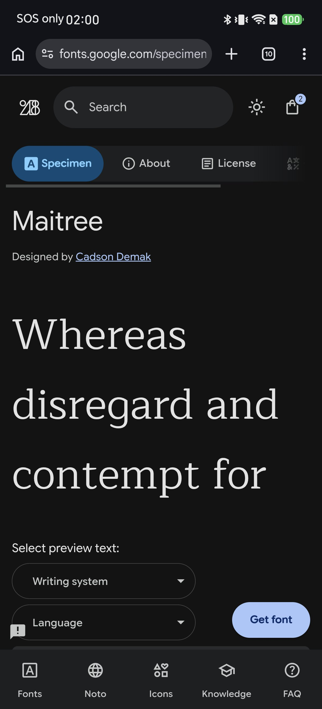

Two things on this page are worth a moment:

- **The description and the sample.** Set the preview to your own writing system and actually look at the letterforms. This is where you decide, not later.
- **The License tab.** Google Fonts families are open-licensed, but the exact licence lives here. For personal reading it never matters; if you plan to embed a font in something you publish, read it.

For body text you want a **regular weight** and a design meant for long reading. Display faces are for covers.

## Step 3: Download the font file

Tap **Get font**. The font joins a selection, and the panel shows what is in it.

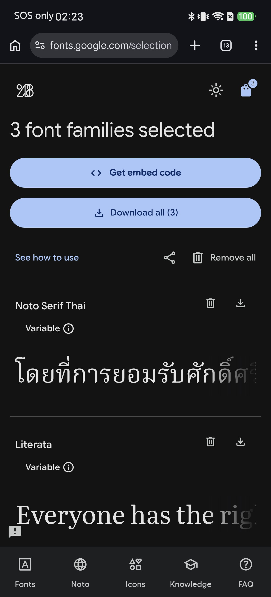

You can add several families before downloading — pick the Thai font and the Latin font in one sitting, then tap **Download all** once. The archive lands in the phone's **Downloads** folder. In this test, one family came to **2.52 MB** and three families to **25.87 MB**.

## Step 4: Look inside the ZIP

Open the archive in your file manager. A single family typically looks like this:

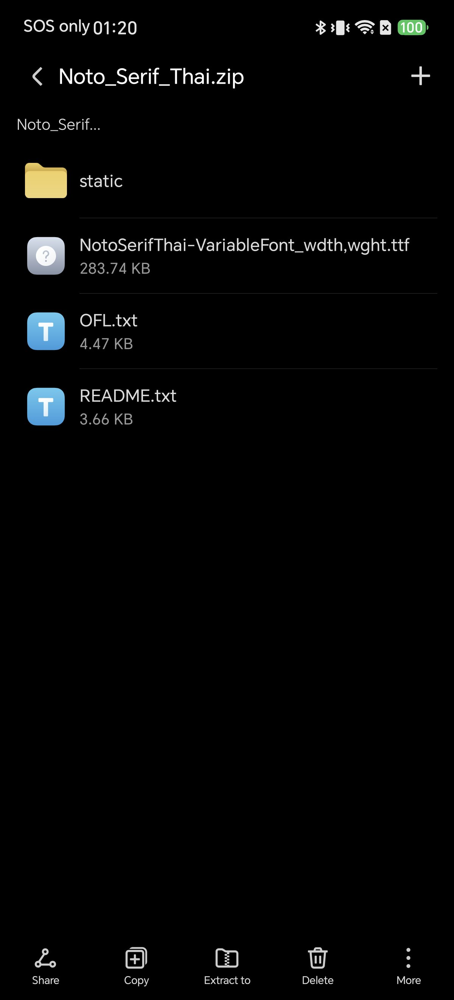

| Entry | What it is |
| --- | --- |
| `<Family>-VariableFont_*.ttf` | The **variable font** — every weight in one file |
| `static/` | One separate file per weight |
| `OFL.txt` | The licence |
| `README.txt` | Notes from the font's authors |

Not every family ships all of these. When you download more than one family the ZIP holds **one folder per family**:

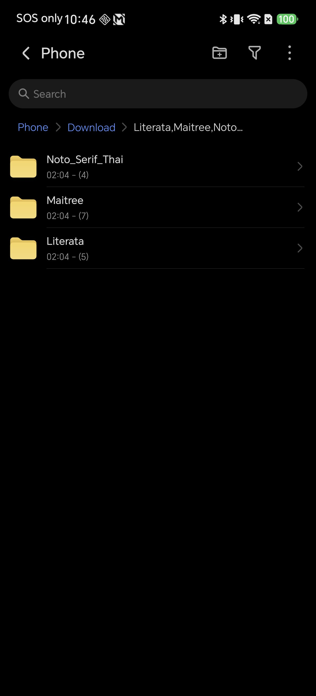

Extract it somewhere you can find again. The file manager on this phone offers **Extract to → Current archive location**, which unpacks it beside the ZIP in Downloads.

## Step 5: Pick the right file out of the folder

This step decides whether the result looks right.

Some families are simple. Maitree is six weights and a licence, all in one folder — no `static/`, no variable file:

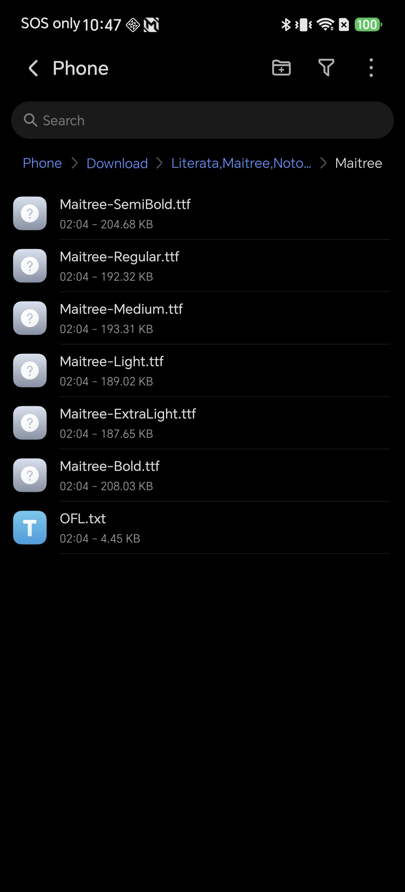

Others are not. Literata's `static/` folder also ships **optical sizes** — `18pt`, `24pt`, `36pt` and `60pt` — each drawn for a different reading size:

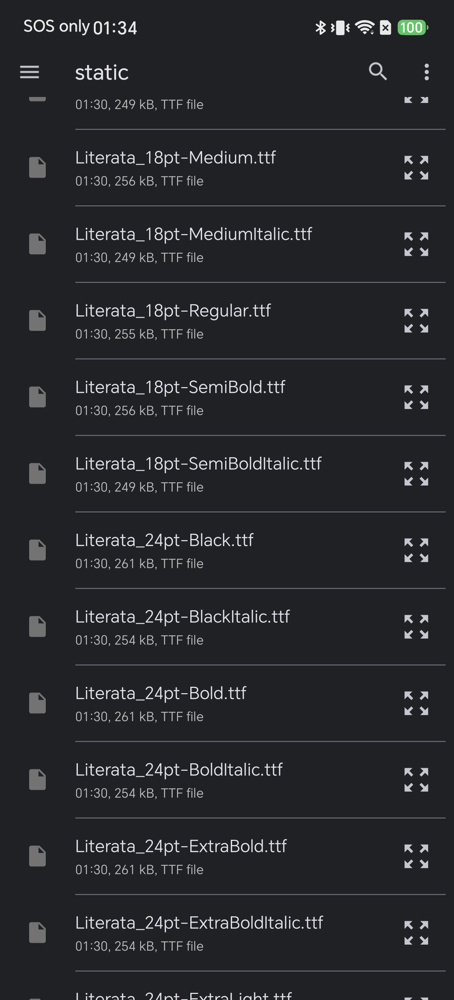

Two rules cover both cases:

- **Take the Regular.** Shiori applies one file as the body font: `Maitree-Regular.ttf`, `Literata_18pt-Regular.ttf` — not Bold, not Black, not Italic.
- **For optical sizes, take the small one.** Body text on a phone is text at reading size, so `18pt`, not `60pt`.

A static Regular is the safest thing to hand the importer, because it is unambiguous about which weight you get.

## Step 6: Open Shiori's per-script font list

In Shiori, go to **Settings → Reading → Reader font**. A dialog opens with one row per script:

Nine rows: **All languages**, then **Thai**, **Latin**, **Japanese**, **Chinese**, **Korean**, **Arabic**, **Cyrillic** and **Devanagari**. Each shows its current setting underneath — `System fonts` when nothing has been chosen.

That layout is the whole feature. A book that mixes scripts is not forced into one typeface. Use **All languages** only if you genuinely want a single font everywhere.

Tap the script you are setting up — **Thai**.

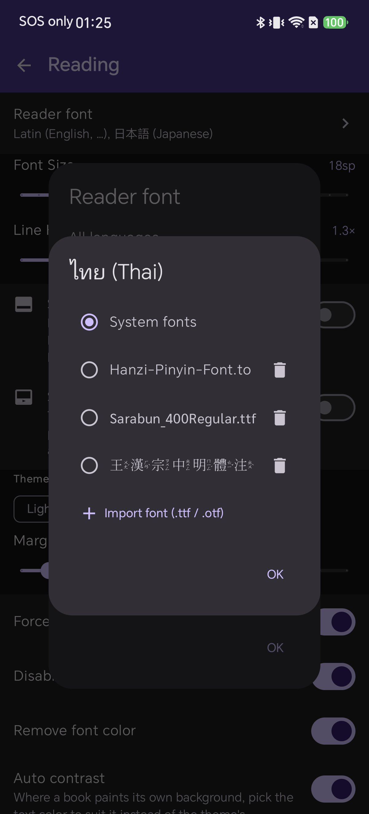

## Step 7: Import the file

Tap **Import font**. Android's file picker opens; navigate to the folder you extracted in Step 4.

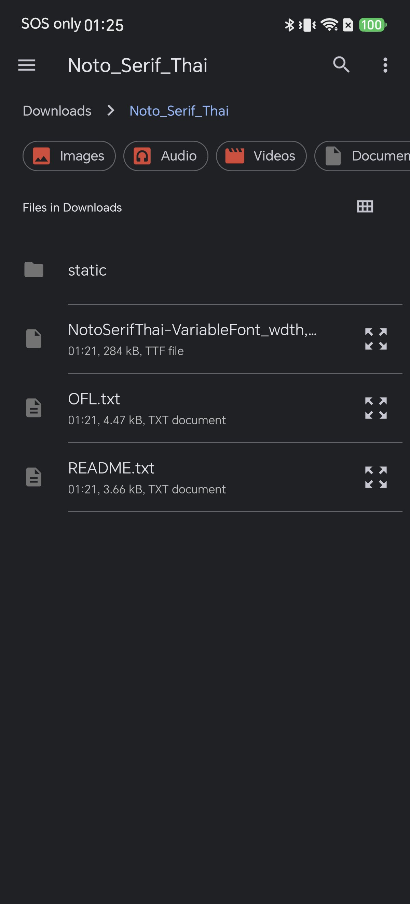

Tap the font file. Shiori imports it, adds it to the list and selects it in one go — there is no separate "apply".

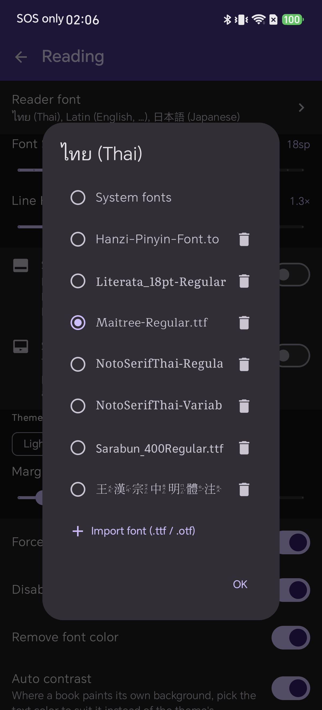

Two details worth knowing:

- **The list is shared.** Every font you import appears in every script's row. Import once, assign wherever you like.
- **The bin icon removes a font** from the library, not just from this script.

Tap **OK** on both dialogs.

## Step 8: See it on a real page

Here is a test document with the same paragraph in six scripts, with the Thai row still set to `System fonts`:

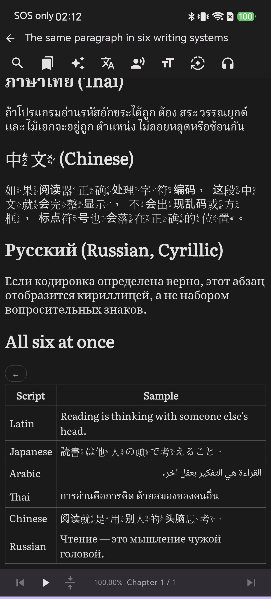

The same page after assigning Maitree to the Thai row:

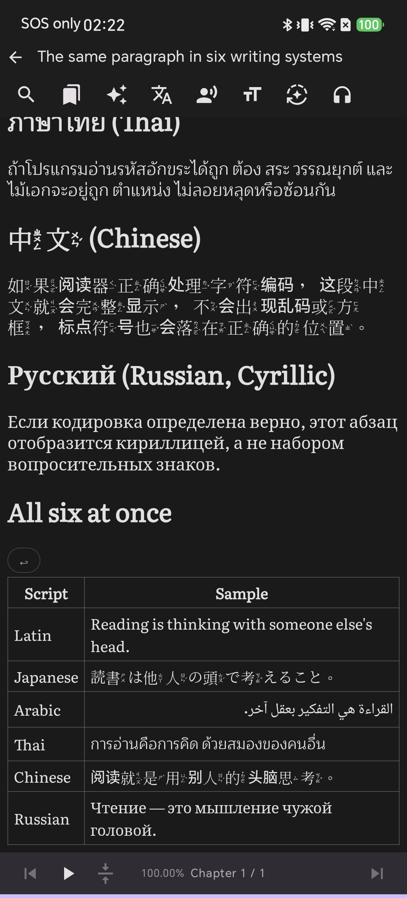

The two Thai table rows side by side, cropped from those two screenshots:

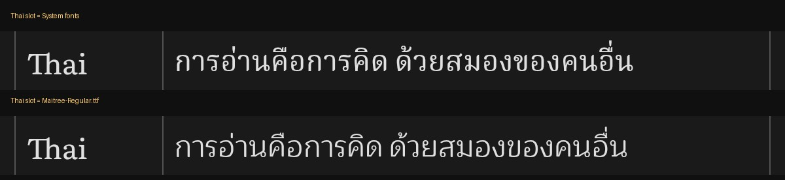

The Thai heading, paragraph and table row changed; the line even rewraps because the new font is wider. Japanese, Chinese and Arabic on the same screen are untouched. That is per-script assignment doing exactly what it says.

## Step 9: Add a second language

Repeat Steps 1 to 7 for the other script you read. For Latin this walkthrough used **Literata**, a serif commissioned for e-reading, importing `Literata_18pt-Regular.ttf` into the **Latin** row.

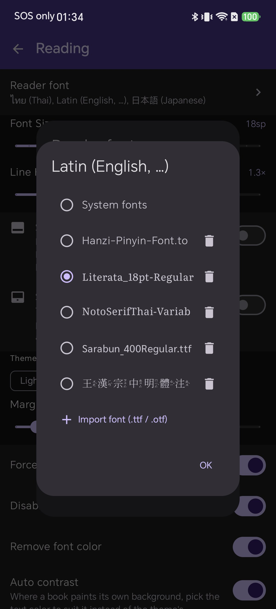

The Reader font dialog then shows both scripts pointing at their own file, and every other row still on the system font:

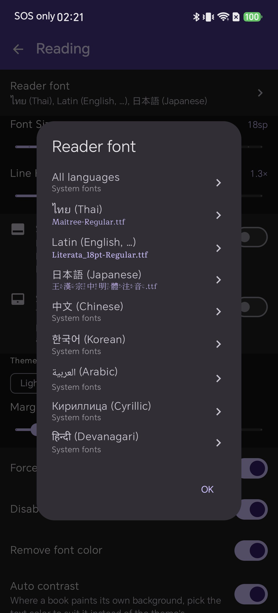

One observation from this test: setting the **Latin** row also changed the **Russian** paragraph on the page. There is a separate **Cyrillic** row if you want to control that script on its own.

## When nothing changes: two traps

Both of these produce the same symptom — you import a font, assign it, reopen the book, and the page looks exactly as it did.

### Trap 1: the font has no glyphs for that script

The first attempt in this walkthrough assigned `Literata_18pt-Regular.ttf` to the **Thai** row. Literata is a Latin family; it contains no Thai letters, so Thai fell straight back to the system font and the page did not move.

Check the row before you blame the app. A Latin file in the Thai row is a no-op.

### Trap 2: you picked a font your phone already uses

This one is harder to spot. The same paragraph, three times, with only the Thai row changed between them:

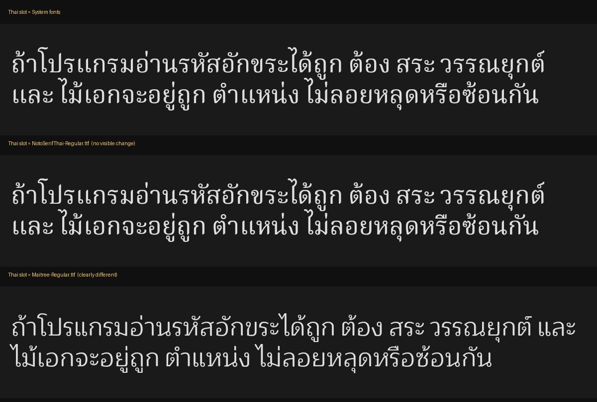

The middle one is `NotoSerifThai-Regular.ttf`, imported from Google Fonts exactly as described above. It is genuinely applied — and it is indistinguishable from the first. Measured pixel by pixel, the paragraph differs from the system-font version by **0.3 %**, which is anti-aliasing noise. With Maitree the same measurement is **13 %**.

The reason is simple: this phone's system Thai font is already a Noto Thai face. Downloading Noto and assigning it replaced the font with a near-identical twin.

So when a change does not show, the first question is not "is the feature broken?" — it is **"is this font actually different from the one I had?"** Put the specimen and your book side by side before you import. Vendors ship Noto for most non-Latin scripts, so a Noto family is often the least visible choice you can make, however good it is.

## Troubleshooting

**Nothing changed after I imported the font.** Read the two traps above first — between them they explain most cases. If neither fits, check that **Force reader fonts** is on, in **Settings → Reading**. When it is off, a book that ships its own CSS fonts keeps them. [Fixing broken EPUB styling](/blog/fix-broken-epub-styling-android/) covers the other overrides on that screen.

**Shiori will not open the file I chose.** The importer takes `.ttf` and `.otf`. A `.zip`, a `.woff2` or a `.ttc` will not do; unpack the archive and pick a real font file out of it.

**I cannot find the extracted folder in the picker.** Extract to a location you can name — Downloads is the easy one — rather than to an app-private cache.

**I picked the wrong file from a long list.** Font lists sort in ways that put `Family-Regular.ttf` far from `Family_Condensed-Regular.ttf`. Read the name in the row after you tap it; the Reader font dialog shows which file each script is using.

**Thai vowels and tone marks sit in the wrong place.** That is the font, not the reader. Try another of the 34 Thai families.

## Tips

- **Test with a real page from the book you actually read**, not a settings preview. Line spacing, weight and mark placement only show themselves in running text.
- **Change one row at a time.** If you set three scripts at once and something looks wrong, you have three suspects.
- **Regular weight, reading-size optical size.**
- **Delete the ZIP afterwards.** Shiori keeps its own copy of an imported font, so the download and the extracted folder are only clutter once the import worked.
- **Fewer fonts, chosen well.** Two good fonts on the two scripts you read beats a library of twenty.

## Related reading

- [How to Import Custom Fonts into Shiori](/blog/how-to-import-custom-epub-fonts/) — the import flow on its own, including the in-reader route
- [Fix Broken EPUB Styling on Android](/blog/fix-broken-epub-styling-android/) — the override switches that decide whether your font wins
- [One Book, Every Voice: Multi-Language Text-to-Speech](/blog/multi-language-text-to-speech-android-epub/) — the read-aloud side of multi-script books
- [An E-Ink Theme for Your Android EPUB Reader](/blog/eink-theme-for-android-epub-reader/) — theme and contrast, the other half of comfortable reading

## Closing

Filter Google Fonts by the script you read, look at the specimen properly, download, unpack, take the Regular, and drop it into the row for that script. If the page does not change, the font either has no letters for that script or is a twin of the one you already had — and both are fixed by going back to the specimen, not by giving up on the setting.
